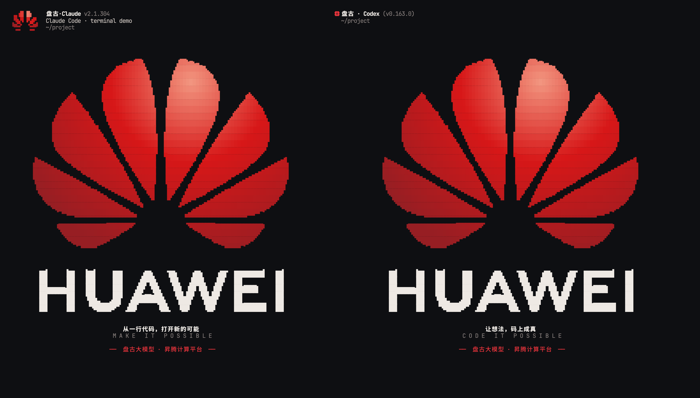
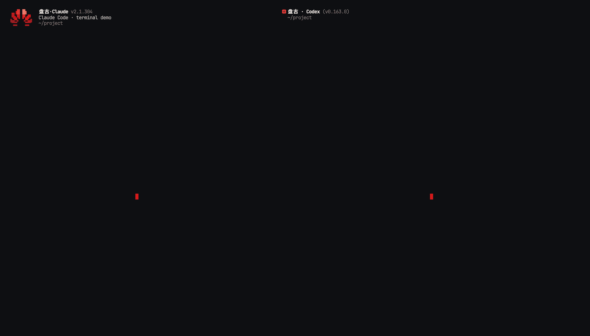

# huawei-bloom

[简体中文](README.md) | **English**

Huawei-style terminal branding for **Claude Code** and **Codex CLI**: a petal intro, a HUAWEI home, and branded headers.  
It does not modify app config, credentials or plugins.

<p align="center">
  
</p>

<p align="center"><sub>Claude Code / Codex · Simplified Chinese · 95×55 / 111×55 cells · demo (session details hidden)</sub></p>

## Features

- Huawei-style eight-petal mark and vector HUAWEI wordmark, rendered with octant glyphs
- One Bloom on launch, then an ambient sweep every 8 seconds, only in cells the app treats as blank
- `盘古·Claude` / `盘古 · Codex` headers; Claude gets a small flower
- Chinese follows the locale: Simplified or Traditional
- `/clear` restores the home; a non-empty submit stops ambient and clears the art
- Direct commands, non-TTY runs and `--raw` bypass the wrapper
- For Codex home, disable welcome in your config; the wrapper injects no startup arguments

## Demo

<p align="center">
  
</p>

<p align="center"><sub>Left: Claude Code · Right: Codex CLI · Simplified Chinese</sub></p>

## Install

Requires macOS or Linux, Python 3.9+, and a Unicode/truecolor terminal; Ghostty is recommended.  
The terminal font must cover the chosen Chinese script.

Clone, then install with `uv` or `pipx`:

```sh
git clone https://github.com/hza2002/huawei-bloom
cd huawei-bloom
uv tool install .
# or
pipx install .
```

If the command is not on your PATH, run `uv tool update-shell` (or `pipx ensurepath`).

For development, link the checkout directly:

```sh
mkdir -p ~/.local/bin
ln -sf /path/to/huawei-bloom/huawei-bloom ~/.local/bin/huawei-bloom
```

Add shell functions:

```zsh
_huawei_bloom() {
  local app=$1; shift
  (( $+commands[huawei-bloom] )) && { command huawei-bloom "$app" "$@"; return; }
  command "$app" "$@"
}
claude() { _huawei_bloom claude "$@"; }
codex() { _huawei_bloom codex "$@"; }
```

`command claude` / `command codex` always bypasses the wrapper.  
Uninstall with `uv tool uninstall huawei-bloom` (or `pipx uninstall huawei-bloom`); for a symlink install, remove the functions and `~/.local/bin/huawei-bloom`.

## Usage

```sh
huawei-bloom [OPTIONS] <claude|codex> [--] [APP ARGS...]
```

| Option | Default | Purpose |
| --- | --- | --- |
| `--logo` / `--no-logo` | on | Header mark only: Claude flower / Codex `✿` |
| `--header` / `--no-header` | on | Header name: `盘古·Claude` / `盘古 · Codex` |
| `--title` / `--no-title` | off | Window title; off by default to keep tmux pane search working |
| `--home` / `--no-home` | on | Bloom, ambient, home; `--no-home` disables the overlay and leaves app settings unchanged |
| `--raw` | off | Run the app untouched |
| `--check` |  | Check embedded patterns, engine, binary and version |

Element flags, `--raw` and `--check` work before or after the app name; `--help` / `--version` after the app are passed to the app.  
Everything after `--` goes to the app.

### Codex home configuration

Codex's native welcome animation occupies the blank area Bloom needs. Turn it off in `~/.codex/config.toml`:

```toml
[tui.effects]
welcome = false
```

To also hide the dynamic hint below the composer (for example `← for agents`), set this in your existing `[tui]` table:

```toml
[tui]
show_tooltips = false
```

Both settings apply to the corresponding `CODEX_HOME`, including Codex windows not launched through the wrapper. The wrapper injects no config overrides, preserving Codex's daemon startup policy and the arguments you explicitly pass. `--no-home` does not re-enable welcome when your config disables it.

## Behavior

- A fresh session plays the intro; the header and prompt are usable immediately.
- `claude -c` / `--resume`, `codex resume` / `fork`, and an initial prompt skip the intro.
- Empty Enter does not interrupt the intro; a non-empty submit stops ambient.
- `/clear` restores the home and ambient when the screen remains eligible.
- Direct / non-interactive commands run without a PTY.

## Compatibility

Verified with Claude Code v2.1.305 and Codex v0.163.0. App updates can change headers or renderers; the wrapper fails open and leaves the app untouched.

## Language

Chinese follows the process locale:

- `zh_TW` / `zh_HK` / `zh_MO` → Traditional
- `zh_CN` / `zh_SG` → Simplified
- non-Chinese locale → Traditional

Override either way:

```sh
AGENT_THEME_LANG=zh-Hans huawei-bloom claude
AGENT_THEME_LANG=zh-Hant huawei-bloom codex
```

README screenshots use Simplified Chinese.

## Environment

| Variable | Default | Purpose |
| --- | --- | --- |
| `AGENT_THEME_GLYPHS` | auto | `octant` / `quadrant`; detects Ghostty, including inside tmux |
| `AGENT_THEME_PALETTE` | auto | `light` / `dark`; from `COLORFGBG` or macOS appearance |
| `AGENT_THEME_CELL_RATIO` | auto, `2.12` fallback | Terminal cell height/width ratio |
| `AGENT_THEME_LANG` | auto, Traditional fallback | `zh-Hant` / `zh-Hans` |
| `AGENT_THEME_DEBUG` | unset | Write overlay timing diagnostics; no default log |

With tmux `automatic-rename` on, the window is named `claude` / `codex`; manually named windows are untouched.  
`#{pane_current_command}` remains Python; use `#{window_name}` / `#W` in status formats.

## Verify

```sh
python3 -m unittest discover -s tests -v
./huawei-bloom --check claude
./huawei-bloom --check codex
```

`--check` validates embedded fixtures, engine, binary and version; it does not run a live TUI or detect future renderer changes. Renderer changes fail open.

See [the benchmark](docs/benchmark.md) for fixed-input renderer comparisons:

```sh
python3 tools/benchmark.py v0.4.1 8bd48b7 worktree
```

## Project layout

```text
huawei-bloom              executable entry point
agent_theme/              CLI, PTY, overlay, animation, i18n, art
docs/                     README images, animation and architecture
CHANGELOG.md              release history
tests/                    stdlib unittest
tools/                    reproducible renderer benchmark
```

## Provenance and license

The Bloom engine, overlay model and Huawei-style artwork are adapted from
[pangu-cli-theme](https://github.com/Lightly20110815/pangu-cli-theme) (MIT, commit
`cefaa53080dd625be9bcc8060051fbbf2dc89723`).

The HUAWEI wordmark is not typeset from a font: `agent_theme/assets/art.json`
stores the `huawei-mark.svg` outlines as polygons, rasterised at 2×4 octant
sub-pixels per character cell (2×2 quadrants on terminals without octants).

Code and layout are MIT-licensed. HUAWEI, the Huawei flower logo and the HUAWEI
wordmark are trademarks of Huawei Technologies Co., Ltd. and are not covered by
that license. This project is not affiliated with Huawei, Anthropic or OpenAI.

## Limitations

- POSIX only; Windows is not supported.
- The home needs blank rows; narrow, short or help-heavy panes may have none.
- After application text, background drawing waits for explicit cursor positioning; text-only renderers may show no background.
- Emoji/combining sequences outside the observer's supported widths disable the background for the rest of that process. Bytes pass through unchanged and header/title replacement continues; restarting the wrapper retries background decoration.
- A typed `/clear` is only a reset candidate: restoring home also requires subsequent app output and a home layout. Pasted commands cannot restore it.
- After resize, decoration waits for an application full clear; unsupported terminal modes pause decoration.
- `--check` is not a substitute for live TUI integration tests.
